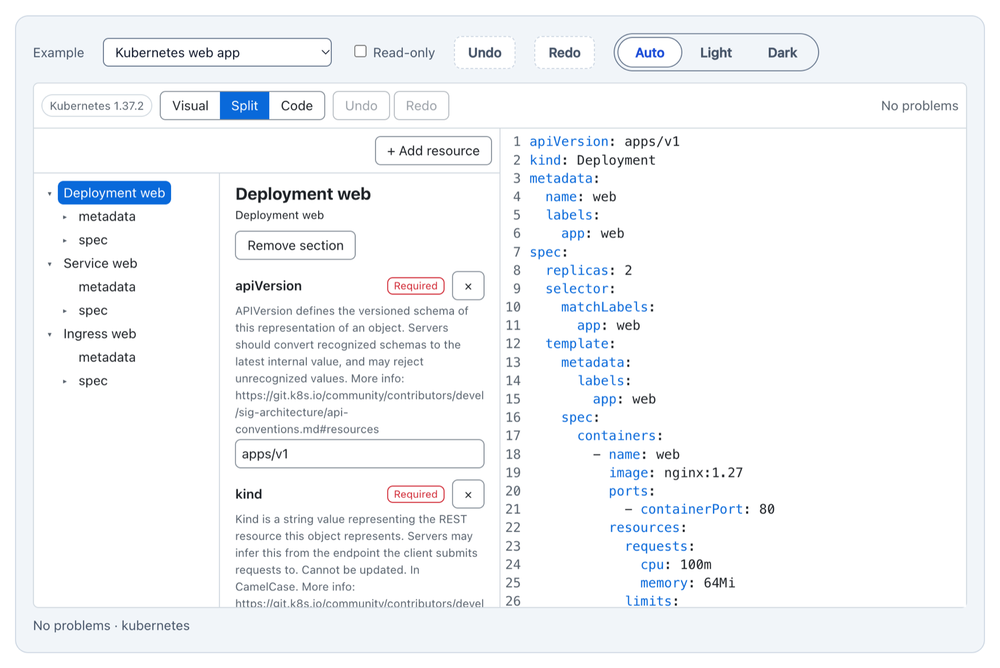

<div align="center">

# stack-weaver

**A visual and code editor for Kubernetes and Compose YAML: schema-driven, round-trip safe, with React and Angular wrappers.**

[](https://www.npmjs.com/package/@mellowforge/stack-weaver-core)
[](https://www.npmjs.com/package/@mellowforge/stack-weaver-react)
[](https://www.npmjs.com/package/@mellowforge/stack-weaver-angular)
[](https://github.com/mellowforge/stack-weaver/actions/workflows/ci.yml)
[](packages/core/schema-sources.lock.json)
[](packages/core/schema-sources.lock.json)
[](LICENSE)

**[Live demo](https://mellowforge.github.io/stack-weaver/)** · [React demo](https://mellowforge.github.io/stack-weaver/react/) · [Angular demo](https://mellowforge.github.io/stack-weaver/angular/) · [Docs](#documentation) · [Contributing](CONTRIBUTING.md)

<picture>
  <source media="(prefers-color-scheme: dark)" srcset="docs/images/demo-dark.png">
  
</picture>

</div>

## Why stack-weaver?

Configuration editors tend to fail in one of two ways. A form-based wizard hides the YAML, walks you through fixed steps and covers only the fields someone wrote a screen for. A plain text editor shows everything but helps with nothing. stack-weaver keeps **the YAML text as the source of truth** and puts a schema-driven form next to it: **every edit in either pane shows up in the other, and the file you get back is the file you gave it, changed only where you changed it.**

- **Two views, one document.** Visual, Split and Code modes edit the same text. Undo and redo span both panes, and focus and selection survive re-renders.
- **Your YAML stays yours.** Paste a manifest, change nothing, and you get the same bytes back. A visual edit touches only the lines of the node it edits: comments, key order, anchors, unknown fields and CRLF line endings survive.
- **Schema-driven, not hand-built.** Fields, hints, required markers and validation come from the pinned Kubernetes OpenAPI and Compose Specification schemas plus a guide overlay. A new field or kind is a data change, never a new screen.
- **Knows what can go here.** The same engine drives the "Add" slots in the form, the "Add resource" picker and completion in the code pane, with recommended fields first.
- **Problems where you are.** Parse errors, schema errors and semantic rules (a Service that selects no workload, a `targetPort` name that doesn't exist, an undeclared `${VAR}` and more) show inline in both panes, with one-click quick fixes.
- **Typed Compose variables.** Declare `${VAR}` placeholders with a type and default in an `x-variables:` block or in a list your app owns; every field gets a "Use variable" toggle that offers only the variables that fit.
- **A blank page that helps.** An empty editor offers starter recipes (Web app, Background worker, Scheduled job, App with Postgres, ...) that insert valid YAML and put focus on the first field to fill in.
- **Accessible, themeable, extensible.** WAI-ARIA patterns (the outline is an APG tree, the mode switch a radio group), light and dark themes through `--sw-*` properties, translatable messages, and public hooks for formats, widgets, recipes and the code editor.

## Packages

| Package | What it is |
| --- | --- |
| [`@mellowforge/stack-weaver-core`](packages/core#readme) | The framework-agnostic editor: document model, formats, validation, visual and code panes, `createManifestEditor`. |
| [`@mellowforge/stack-weaver-react`](packages/react#readme) | `<ManifestEditor>` for React 19, safe under `<StrictMode>` and server rendering. |
| [`@mellowforge/stack-weaver-angular`](packages/angular/projects/stack-weaver-angular#readme) | `<sw-manifest-editor>` for Angular 22: standalone, signals, with or without zone.js. |

The wrappers only wire props and inputs to the core, so they behave the same way and are shown side by side in the [demo](https://mellowforge.github.io/stack-weaver/).

## Installation

```bash
npm install @mellowforge/stack-weaver-core @mellowforge/stack-weaver-react     # React
npm install @mellowforge/stack-weaver-core @mellowforge/stack-weaver-angular   # Angular
npm install @mellowforge/stack-weaver-core                                     # anything else
```

The default code pane is CodeMirror 6, loaded on first use. Its packages are peer dependencies of the core, so install them too, or pass your own `CodeEditorAdapter` and skip them:

```bash
npm install @codemirror/autocomplete @codemirror/commands @codemirror/lang-yaml @codemirror/language \
  @codemirror/lint @codemirror/state @codemirror/view @lezer/highlight
```

Keep every `@mellowforge/stack-weaver-*` package on the same version: they are released in lockstep.

| Peer dependency | Needed by |
| --- | --- |
| `@mellowforge/stack-weaver-core` | both wrappers (`0.x`: keep it on the same version) |
| `@codemirror/*`, `@lezer/highlight` | the core's default code pane |
| `react`, `react-dom` | `@mellowforge/stack-weaver-react` (`^19`) |
| `@angular/core`, `@angular/common` | `@mellowforge/stack-weaver-angular` (`^22`) |

All packages are ESM-only. Import the stylesheet once, `@mellowforge/stack-weaver-core/stack-weaver.css`; the wrappers ship no CSS of their own.

## Quick start

Give the editor a **height**: it fills its host element.

### React

```tsx
import '@mellowforge/stack-weaver-core/stack-weaver.css';

import { useState } from 'react';
import { ManifestEditor } from '@mellowforge/stack-weaver-react';

export function DeploymentEditor() {
  const [yaml, setYaml] = useState('apiVersion: v1\nkind: ConfigMap\nmetadata:\n  name: app\n');
  return (
    <ManifestEditor
      style={{ height: 560 }}
      value={yaml}
      onChange={setYaml}
      format="auto"
      mode="split"
      onProblemsChange={problems => console.log(`${problems.length} problems`)}
    />
  );
}
```

### Angular

```ts
import { Component, signal } from '@angular/core';
import { SwManifestEditor } from '@mellowforge/stack-weaver-angular';

@Component({
  selector: 'app-deployment-editor',
  imports: [SwManifestEditor],
  template: `
    <sw-manifest-editor
      style="height: 560px"
      [(value)]="yaml"
      [(mode)]="mode"
      format="auto"
      (problemsChange)="problems.set($event.length)"
    />
    <p>{{ problems() }} problems</p>
  `,
})
export class DeploymentEditor {
  readonly yaml = signal('apiVersion: v1\nkind: ConfigMap\nmetadata:\n  name: app\n');
  readonly mode = signal<'visual' | 'split' | 'code'>('split');
  readonly problems = signal(0);
}
```

Add `@import '@mellowforge/stack-weaver-core/stack-weaver.css';` to your global `styles.css`.

### Any framework, or none

```ts
import '@mellowforge/stack-weaver-core/stack-weaver.css';

import { createManifestEditor } from '@mellowforge/stack-weaver-core';

const editor = createManifestEditor(document.getElementById('editor')!, {
  format: 'auto', // 'kubernetes' | 'compose' | 'auto'
  mode: 'split', // 'visual' | 'split' | 'code'
  value: 'services:\n  web:\n    image: "nginx:${TAG}"\n',
  variables: { store: 'x-variables' }, // declare ${TAG} in the file itself
  onChange: (value, { origin }) => console.log(origin, value.length),
});

await editor.ready;
// Replace the text from outside: a no-op when it is unchanged, otherwise a minimal diff, so the caret stays put.
editor.setValue(await fetch('/compose.yaml').then(r => r.text()));
editor.destroy();
```

## How it works

```text
  form edit ──▶ CST edit of that node ──▶ minimal text diff ──┐
                                                               ▼
  code pane typing ─────────────────────────────────▶  YAML text (the only state, one undo history)
                                                               │ parse
                                                               ▼
  outline + form ◀──── rendered by YAML path ◀────────  document model
                                                               │
                                                               ▼
  parse errors → schema (ajv, precompiled) → semantic rules → problems in both panes
```

The text is the only state. Typing in the code pane re-parses it; the visual pane re-renders from the parse, addressing nodes by their YAML path so selection and focus survive. A visual edit is applied to the concrete syntax tree of just that node, and only the resulting text diff reaches the code pane. While the YAML is broken, the visual pane shows the last valid state read-only, with a "Jump to error" link, and never writes.

Formats are data. A format bundles a detector, a JSON Schema per kind (lazy-loaded, with validators precompiled at build time, so there is no `new Function` and no CSP issue), a guide overlay for labels, grouping and recommended fields, starter recipes and semantic rules. The core entry has no schemas at all: Kubernetes kinds load on demand, one chunk per kind.

| Format | Schema | Rules |
| --- | --- | --- |
| Kubernetes | Upstream OpenAPI v3, Kubernetes 1.37 | `service-selector`, `selector-mismatch`, `missing-resources`, `target-port` |
| Compose | `compose-spec/compose-spec` schema, pinned to a commit | `undeclared-variable`, `variable-default`, `variable-declaration`, `variable-type` |

You can register your own formats, swap the guide text, add widgets, replace recipes, translate the UI or plug in another code editor; see the [core README](packages/core#readme).

## Documentation

- **[Core](packages/core#readme)**: every option and controller method, formats as data, Compose variables, semantic rules and quick fixes, recipes, the code editor adapter, theming, messages and widgets.
- **[React](packages/react#readme)**: props, controlled and uncontrolled use, which props are init-only, and the `ref` controller.
- **[Angular](packages/angular/projects/stack-weaver-angular#readme)**: inputs, outputs, two-way bindings, zone.js and zoneless use, and `controller()`.
- **[Demo site](https://mellowforge.github.io/stack-weaver/)**: the same editor in Vanilla JS, React and Angular, with examples for both formats.
- **Design**: the [design spec](docs/superpowers/specs/2026-10-30-stack-weaver-design.md).

## Compatibility

- **React** 19, including `<StrictMode>` and server rendering (the editor mounts after hydration).
- **Angular** 22+, standalone, signal inputs and `model()` bindings; works with zone.js and zoneless.
- **Browsers**: current Chrome, Edge, Firefox and Safari (ES2022).
- **Kubernetes** schemas for 1.37; the repository's generator script builds other versions, which can be registered as formats.

## Limitations

- **No cluster connection.** No apply or dry-run, no live state, no schemas fetched from a cluster.
- **One document in, one out.** No multi-file projects: a folder of manifests or a `.env` file next to a compose file is out of scope.
- **No CRD schemas.** Unknown kinds are kept byte for byte and shown as "Unknown kind, edit in code".
- **No Helm or Kustomize.** Templates, `values.yaml` and `kustomization.yaml` are not supported.
- **Some YAML stays in code.** Nodes the editor can't change faithfully (flow collections, unusual block scalars, nodes reached through an alias) are read-only in the form, with an "Edit in code" hint, and are never reformatted.

## Contributing

Bug reports, docs fixes and pull requests are welcome: see [CONTRIBUTING.md](CONTRIBUTING.md) for the setup, the development loop and the release process.

## License

[MIT](LICENSE) © 2026 Konstantin Penzin
